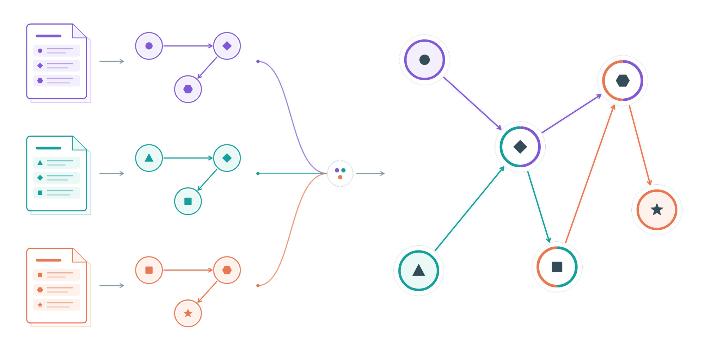
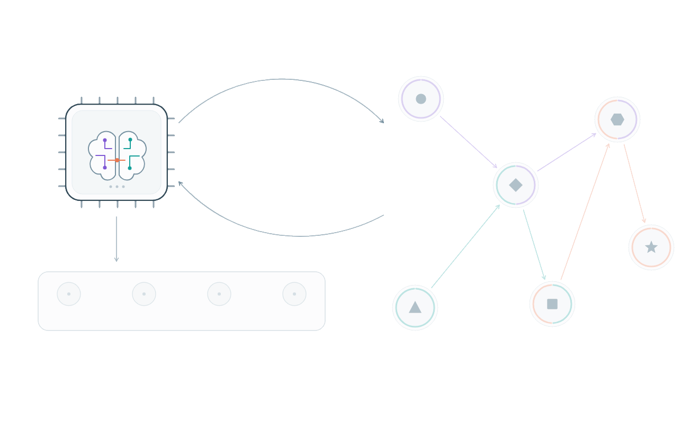
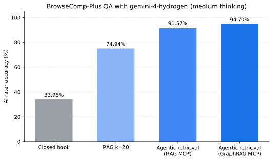
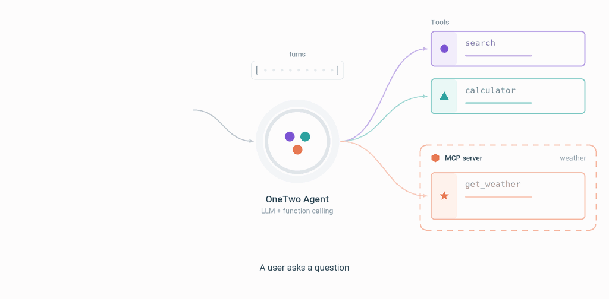

# OneTwo

<div align="center">
  
</div>

<div style=" font-size: 25px; line-height: normal; text-align: justify; max-width: 600px; margin: auto;">
<span style="color: #fbb95d; font-weight: bold;">One</span><span style="color: #fb8987; font-weight: bold;">Two</span> is a Python library for developing and deploying LLM
agents and RAG workflows in production. In just a few lines of code, you can
<span style="color: #3cba54; font-weight: bold;">build RAG pipelines</span> and <span style="color: #4885ed; font-weight: bold;">define custom agents</span> using our extensive library of
<span style=" color: #db3236; font-weight: bold;">pre-built
components</span>. </div>

## 🔥 Features

*   **Build end-to-end RAG pipelines (Retrieval-Augmented Generation)**: Build
    an index over your documents and evaluate RAG quality in just two function
    calls.
*   **Swap models easily (Model-agnostic)**: Write code once using a uniform API
    and run it on any model without changing your logic.
*   **Write prompts your way (Convenient syntax)**: Build prompts flexibly using
    formatted strings, Jinja templates, or modular function calls.
*   **Run reproducible experiments**: Automatically cache results to replay
    experiments instantly and save quota without making redundant requests.
*   **Equip models with tools**: Seamlessly integrate external tools, including
    running model-generated Python code in a secure sandbox.
*   **Build and combine agents**: Define and compose stateful agents to perform
    complex, step-by-step actions.
*   **Forget about execution details (Efficient & Flexible)**: Focus on your
    workflow while OneTwo automatically handles asynchronous execution, request
    batching, and smart caching.

## Installation

OneTwo requires Python 3.13 or later.

You may want to install the package in a virtual environment, in which case you
will need to start a virtual environment with the following command:

```shell
python3 -m venv PATH_TO_DIRECTORY_FOR_VIRTUAL_ENV
# Activate it.
. PATH_TO_DIRECTORY_FOR_VIRTUAL_ENV/bin/activate
```

Once you no longer need it, this virtual environment can be deleted with the
following command:

```shell
deactivate
```

Install the package:

```shell
pip install git+https://github.com/google-deepmind/onetwo
```

## 📝 Usage example

```python
from onetwo import ot
from onetwo.builtins import llm
from onetwo.backends import google_genai_api

# Before running: export GOOGLE_API_KEY="YOUR_API_KEY"

# Select a model + the backend (e.g., Gemini API).
google_genai_api.GoogleGenAIAPI(
    vertexai=False,
    model_name='gemini-4-hydrogen',
).register()

# Define a prompting strategy with two LLM calls.
@ot.make_executable
async def invention_year(technology: str) -> int:
  """Get the year a technology was invented."""
  inventor = await llm.instruct(f"Who is the primary inventor of {technology}? Answer with just the name.")
  year = await llm.generate_object(f"In what year did {inventor} invent {technology}?", cls=int)
  return year


# Run the strategy for a single example.
year = ot.run(invention_year("World Wide Web"))
print(f"The World Wide Web was invented in: {year}")
```

Play with this snippet in the
[getting started tutorial](https://colab.research.google.com/github/google-deepmind/onetwo/blob/main/colabs/getting_started.ipynb).

## 🔍 Retrieval-Augmented Generation (RAG)

OneTwo provides a streamlined framework to integrate **Retrieval-Augmented
Generation (RAG)** capabilities into production workflows. Specifically, you can
build knowledge graphs from arbitrary corpora and evaluate question-answering
pipelines in just two function calls:

**1. Index building (`rag.build_index`):** turns your custom corpus into a
searchable index

```python
from onetwo import rag
from onetwo.evaluation import datasets

# Before running: export GOOGLE_API_KEY="YOUR_API_KEY"

# 1. Build an index over your corpus
index = rag.build_index(
    corpus=datasets.get_dataset_loader('browsecomp_plus'),
    index='embedding',
    output='/tmp/onetwo_rag_index'
)
```

**Going further:** with `index='graphrag'`, `rag.build_index` builds a
GraphRAG index instead. It extracts the entities and relations of each document
and merges them into a single knowledge graph as shown below:



**2. Index serving & evaluation (`rag.evaluate`):** evaluates a
question-answering strategy that uses the index built in step 1. With
`strategy='rag'`, the model retrieves once per question and then answers.

```python
# 2. Serve the index and evaluate RAG performance
summary = rag.evaluate(
    examples=datasets.get_dataset_loader('browsecomp_plus'),
    index=index,
    strategy='rag',
    output='/tmp/onetwo_rag_eval'
)
```

**Going further:** with `strategy='agentic_retrieval'`, the model acts as an
agent that searches the index step by step. Serve the index as an MCP server
with `server = rag.start_mcp_in_background(index)`, and pass
`mcp_urls=[server.url]` instead of `index` to `rag.evaluate`. Below, an agent
queries a GraphRAG index over MCP:



See our [BrowseComp-Plus guide](docs/browsecomp_plus_qa.md) for the commands to
reproduce the results below:



Want to build and benchmark your own RAG workflows? Check out our
[RAG tutorial](https://colab.research.google.com/github/google-deepmind/onetwo/blob/main/colabs/rag_tutorial.ipynb).

## 🧠 OneTwo Agents

OneTwo makes it really easy to build stateful, autonomous agents that can
reason, use tools, and solve complex problems. Compose agents naturally using
Python control flow while OneTwo takes care of batching, streaming, and
execution details behind the scenes.



Want to create and play with this agent? Check out our
[in-depth tutorial](https://colab.research.google.com/github/google-deepmind/onetwo/blob/main/colabs/tutorial.ipynb).

## Running unit tests

In order to run the tests, first clone the repository and install the package:

```shell
git clone https://github.com/google-deepmind/onetwo
cd onetwo
pip install .
```

Then invoke `pytest`:

```shell
pytest onetwo
```

## Documentation

*   [Question Answering on BrowseComp-Plus](docs/browsecomp_plus_qa.md): build
    embedding-based and graph-based (GraphRAG) indexes over the BrowseComp-Plus
    corpus, then evaluate closed-book, RAG and agentic retrieval strategies on
    them.
*   [Multimodal RAG: the SpanishGov case study](docs/multimodal_rag.md): build
    a custom dual-modal (text and image) index with its own MCP server, and
    compare it to the standard index MCP server on questions that need both text
    and images.

## Citing OneTwo

If you have found OneTwo useful in your research, please cite it in your
publications as follows:

```bibtex
@software{onetwo2026github,
  author = {Olivier Bousquet and Parth Kothari and Elias Abad Rocamora and Nathan Scales and Nathanael Sch{\"a}rli and Ilya Tolstikhin},
  title = {{O}ne{T}wo: {I}nteracting with {L}arge {M}odels},
  url = {https://github.com/google-deepmind/onetwo},
  version = {0.5.0},
  date = {2026-06-02},
  year = {2026}
}
```

In the above BibTeX entry, names are in alphabetical order, the version number
is intended to be the one returned by `ot.__version__` (i.e., the latest version
mentioned in [version.py](version.py)) and in the [CHANGELOG](CHANGELOG.md), and
the year and date correspond to the release of this specific version.

## License

Copyright 2024 DeepMind Technologies Limited

This code is licensed under the Apache License, Version 2.0 (the \"License\");
you may not use this file except in compliance with the License. You may obtain
a copy of the License at http://www.apache.org/licenses/LICENSE-2.0.

Unless required by applicable law or agreed to in writing, software distributed
under the License is distributed on an AS IS BASIS, WITHOUT WARRANTIES OR
CONDITIONS OF ANY KIND, either express or implied. See the License for the
specific language governing permissions and limitations under the License.

## Disclaimer

This is not an official Google product.
