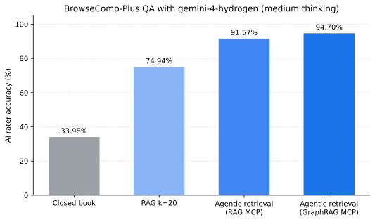

# Tutorial: Question Answering (QA) on BrowseComp-Plus

OneTwo enables you to build an index, serve it and evaluate QA strategies
easily. In this tutorial, we show how to do this for the
[BrowseComp-Plus](https://huggingface.co/datasets/Tevatron/browsecomp-plus)
benchmark. The BrowseComp-Plus benchmark consists of 830 questions, which should
be answered by browsing a corpus of ~100k documents. This tutorial shows how to
build simple embedding-based indexes and advanced graph-based indexes with
OneTwo. We then show how to use these indexes during QA with simple RAG
strategies, but also how to serve and evaluate them with OneTwo's MCP servers.



*Figure 1: BrowseComp-Plus results with Gemini 4 Hydrogen (medium effort). All
indexes use `gemini-embedding-2` with 768-dimensional embeddings over whole
documents (no chunking). Gemini-3.6-Flash is used as the AI rater.*

## 0. Setup

Please [set up your Gemini API key](https://aistudio.google.com/docs/api-key)
and choose where to save the indexes and results.

```sh
pip install git+https://github.com/google-deepmind/onetwo

export GOOGLE_API_KEY="YOUR_API_KEY"
# Passed to all the commands below: the API key, and the number of parallel
# requests to the Gemini API (the default is 1). Lower it if you hit API rate
# limits.
export EXTRA_BACKEND_KWARGS="{\"api_key\": \"${GOOGLE_API_KEY}\", \"threadpool_size\": 10}"

# Where the indexes and the evaluation results are saved.
export BASELINE_INDEX_DIR=~/onetwo_indexes/baseline
export GRAPHRAG_INDEX_DIR=~/onetwo_indexes/graphrag
export EVAL_DIR=~/onetwo_evals
```

## 1. Build the indexes

The next step is to index the corpus. Since the corpus is large, we recommend
running without chunking in this case. For this purpose, we use the
`--chunker_type=none` flag. By default, a chunk size of 512 tokens is used for
text chunks. Remove the `--chunker_type=none` flag to use the default chunking.

Each index is saved under `<output>/browsecomp_plus/<index config>/`. Both use
`gemini-embedding-2` with 768-dimensional embeddings over whole documents (no
chunking). Add `--max_documents=10` for a quick smoke test.

### Baseline (embedding) index

This index computes one embedding for each document in the corpus, i.e., ~100k
embeddings.

```sh
python -m onetwo.stdlib.retrieval.build_index \
  --corpus=browsecomp_plus \
  --chunker_type=none \
  --embedding_model_name=gemini-embedding-2 \
  --embed_kwargs='{"output_dimensionality": 768}' \
  --output="${BASELINE_INDEX_DIR}" \
  --extra_backend_kwargs="${EXTRA_BACKEND_KWARGS}"

export BASELINE_INDEX=$(echo "${BASELINE_INDEX_DIR}"/browsecomp_plus/*)
```

### GraphRAG (HippoRAG) index

This index uses an LLM to extract entities and relationships from each document,
following a similar process to [GraphRAG](https://arxiv.org/abs/2404.16130) and
[HippoRAG](https://arxiv.org/abs/2502.14802). By default the extractor model is
`gemini-4-hydrogen` with low effort. Each entity and document is embedded with
`gemini-embedding-2` with 768-dimensional embeddings.

```sh
python -m onetwo.stdlib.retrieval.build_index \
  --corpus=browsecomp_plus \
  --index_type=graphrag \
  --chunker_type=none \
  --embedding_model_name=gemini-embedding-2 \
  --embed_kwargs='{"output_dimensionality": 768}' \
  --output="${GRAPHRAG_INDEX_DIR}" \
  --extra_backend_kwargs="${EXTRA_BACKEND_KWARGS}"

export GRAPHRAG_INDEX=$(echo "${GRAPHRAG_INDEX_DIR}"/browsecomp_plus/*)
```

During our run, the LLM extracted 1,799,968 entities (after merging duplicates)
and 2,695,813 relationships between them from the ~100k documents.

## 2. Run the QA evals

After building the indexes, we can run the QA evals. OneTwo's `evaluate_rag`
allows evaluating any QA strategy, ranging from closed-book QA to RAG to
MCP-based QA. `evaluate_rag` runs on BrowseComp-Plus by default. Results are
saved under `<output>/browsecomp_plus/<strategy>/<model>__max_results_<N>/` in
an html file. This file contains each question, answer, metric and LLM trace
computed during the evaluation. Add `--max_examples=5` for a quick smoke test.

### Closed book

Closed-book strategies are useful to measure the baseline knowledge of the
model, without any retrieval. The model is given the question and asked to
generate an answer, without any additional context.

```sh
python -m onetwo.stdlib.qa.evaluate_rag \
  --qa_strategy_name=closed_book \
  --output="${EVAL_DIR}/closed_book" \
  --extra_backend_kwargs="${EXTRA_BACKEND_KWARGS}"
```

### RAG

RAG strategies retrieve from an index with the given question. The model is
given the question and the retrieved documents and asked to generate an answer.
The success of this strategy mainly depends on the retrieval quality of the
index.

```sh
python -m onetwo.stdlib.qa.evaluate_rag \
  --index="${BASELINE_INDEX}" \
  --qa_strategy_name=rag \
  --output="${EVAL_DIR}/rag" \
  --extra_backend_kwargs="${EXTRA_BACKEND_KWARGS}"
```

### Agentic retrieval

The most powerful strategy. In this case, we wrap the indexes in an MCP server.
Retrieval is no longer a single step where the LLM doesn't have a choice. The
LLM can run multiple retrieval calls and decide which queries to send.

#### Baseline index

First, start the RAG MCP server, which serves the baseline index on
http://localhost:8775/mcp, in its own terminal:

```sh
python -m onetwo.stdlib.retrieval.mcp.mcp_server_main \
  --index_path="${BASELINE_INDEX}" \
  --transport=streamable-http \
  --port=8775 \
  --extra_backend_kwargs="${EXTRA_BACKEND_KWARGS}"
```

Then, once the server is running, run the evaluation in a different terminal:

```sh
python -m onetwo.stdlib.qa.evaluate_rag \
  --qa_strategy_name=agentic_retrieval \
  --mcp_urls=http://localhost:8775/mcp \
  --output="${EVAL_DIR}/rag_mcp" \
  --extra_backend_kwargs="${EXTRA_BACKEND_KWARGS}"
```

#### GraphRAG index

First, start the GraphRAG MCP server, which serves the GraphRAG index on
http://localhost:8776/mcp, in its own terminal:

```sh
python -m onetwo.stdlib.retrieval.graphrag.mcp_server_main \
  --index_path="${GRAPHRAG_INDEX}" \
  --transport=streamable-http \
  --port=8776 \
  --extra_backend_kwargs="${EXTRA_BACKEND_KWARGS}"
```

Then, once the server is running, run the evaluation in a different terminal:

```sh
python -m onetwo.stdlib.qa.evaluate_rag \
  --qa_strategy_name=agentic_retrieval \
  --mcp_urls=http://localhost:8776/mcp \
  --output="${EVAL_DIR}/graphrag_mcp" \
  --extra_backend_kwargs="${EXTRA_BACKEND_KWARGS}"
```

## 3. Results

We ran the commands above and the results are shown below.

*Table 1: BrowseComp-Plus results with Gemini 4 Hydrogen (medium effort). All
indexes use `gemini-embedding-2` with 768-dimensional embeddings over whole
documents (no chunking). Gemini-3.6-Flash is used as the AI rater.*

Strategy            | Index    | AI rater accuracy | Avg. tool calls
:------------------ | :------- | ----------------: | --------------:
`closed_book`       | –        | 33.98%            | –
`rag`               | Baseline | 74.94%            | –
`agentic_retrieval` | Baseline | 91.57%            | 27.39
`agentic_retrieval` | GraphRAG | 94.70%            | 21.47

See the
[RAG tutorial](https://colab.research.google.com/github/google-deepmind/onetwo/blob/main/colabs/rag_tutorial.ipynb)
for the same flow from Python (`rag.build_index` / `rag.evaluate`).
